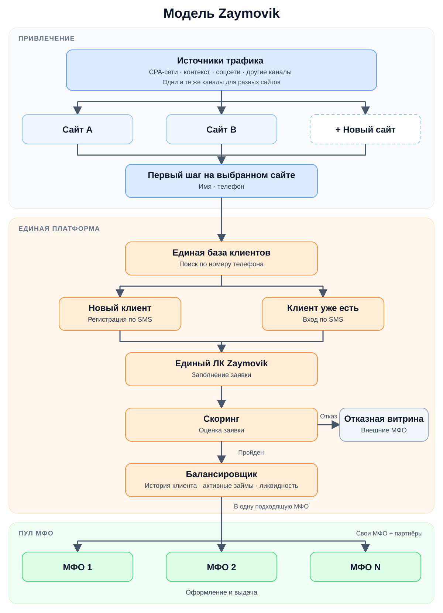

# Zaymovik: основная бизнес-модель

Обновлено: 15 октября 2026 года
Статус: базовая концепция

## 1. Суть модели

> **Главное:** несколько сайтов привлекают клиентов из разных источников трафика и подключаются к одной платформе Zaymovik. Клиент начинает заявку на сайте, а продолжает в едином ЛК. Скоринг определяет допуск к выдаче, балансировщик выбирает одну готовую МФО — собственную или партнёрскую. Деньги выдаёт МФО, а не платформа.

### Общая схема



### Участники модели

- **Источники трафика** — CPA-сети, контекстная реклама, соцсети и другие каналы привлечения. Одни и те же каналы можно использовать для разных сайтов.
- **CPA-сеть** — площадка, которая связывает рекламодателя с поставщиками трафика. CPA расшифровывается как Cost per Action — оплата за согласованное целевое действие, например за принятую заявку или выдачу займа.
- **Оффер** — карточка партнёрской программы: отдельный сайт или бренд, условия привлечения, ставка вознаграждения и правила зачёта целевого действия.
- **Веб-мастер или финансовая витрина** — поставщик трафика, который размещает оффер и направляет на сайт пользователей.
- **МФО** — собственная или партнёрская микрофинансовая организация, которая оформляет договор и выдаёт деньги допущенному скорингом клиенту.
- **Заявка** — данные клиента для получения займа. На сайте собираются имя и телефон, остальная анкета заполняется в едином ЛК.
- **Единая база клиентов** — общая база для всех сайтов: по номеру телефона определяется, нужно зарегистрировать клиента или войти в уже существующий аккаунт.
- **ЛК Zaymovik** — единый личный кабинет на zaymovik.ru для заполнения заявки и работы с займом. Отдельные кабинеты на сайтах привлечения не нужны.
- **Скоринг платформы** — оценка заявки, которая даёт скоринговый балл. Его сравнивают с **порогом отсечения** — минимальным баллом для допуска к выдаче.
- **Балансировщик** — компонент платформы, который после скоринга выбирает одну готовую выдать МФО с учётом истории клиента, активных займов, ликвидности и лимитов.
- **Отказная витрина** — внешние предложения МФО для клиентов, не прошедших скоринг.

Модель состоит из двух слоёв:

- **снаружи** — несколько самостоятельных сайтов и брендов с разными каналами привлечения, включая CPA-офферы;
- **внутри** — единая база клиентов, один ЛК, общий скоринг, балансировщик, собственные МФО и возможность подключать партнёрские.

```text
Источники трафика → сайты → единая база клиентов
→ регистрация или вход по SMS → единый ЛК → скоринг
→ балансировщик → одна готовая МФО → оформление и выдача

Отказ на скоринге → отказная витрина
```

**Несколько сайтов снаружи работают как один бизнес внутри:** сайты привлекают клиентов, единая платформа обрабатывает и распределяет заявки, а деньги выдаёт выбранная МФО.

## 2. Зачем несколько сайтов

Каждый сайт — отдельная точка привлечения: для него можно запускать CPA-оффер, рекламные кампании и выделять отдельный бюджет. При этом все сайты используют общую базу, ЛК и обработку заявок. Ниже сохранён пример экономики именно CPA-канала.

Один сайт обычно выводится в CPA-сеть как один бренд и один оффер. Несколько сайтов позволяют создать несколько отдельных карточек, участвовать в нескольких ротациях — очередях и наборах размещений у поставщиков трафика — и получать трафик от большего числа веб-мастеров.

### Почему большому офферу требуется более высокий EPC

Веб-мастера сравнивают офферы по доходности и направляют больше трафика тем, на которых зарабатывают больше. У одного оффера ограничен объём трафика, доступный при текущей доходности. Чтобы один оффер вырос, например, с 300 тыс. до 1 млн переходов, ему приходится конкурировать за следующий, более дорогой слой трафика.

Для сравнения офферов используется **EPC — Earnings per Click**, средний заработок веб-мастера на один учтённый переход:

```text
EPC = подтверждённая выплата веб-мастеру / количество учтённых кликов
```

В CPA-сети обычно оплачивается не сам клик, а целевое действие. Поэтому EPC — не тариф за клик, а пересчёт всех подтверждённых выплат в среднюю сумму на один переход.

Три самостоятельных оффера могут получить примерно по трети требуемого объёма каждый, не поднимаясь в тот же дорогой диапазон EPC, который нужен одному офферу для выкупа всего миллиона переходов.

> **Рабочая гипотеза проекта:** одному офферу для привлечения около 1 млн переходов нужен EPC не ниже 150 ₽. Портфель, то есть совокупность из трёх отдельных офферов, может суммарно привлечь тот же объём: примерно по 333 тыс. переходов на оффер при EPC около 90 ₽.

### Иллюстративный расчёт на 1 млн переходов

Расчёт основан на внутренних наблюдениях `150 ₽ против 90 ₽` и показывает эквивалентную сумму выплат веб-мастерам. Это рабочая оценка, а не универсальное правило CPA-рынка.

| Сценарий | Распределение переходов | EPC | Эквивалентная выплата веб-мастерам |
|---|---:|---:|---:|
| Один домен | 1 оффер × 1 000 000 | 150 ₽ | 150 млн ₽ |
| Три домена | 3 оффера × ~333 333 | около 90 ₽ | около 90 млн ₽ |

```text
Один оффер: 1 000 000 × 150 ₽ = 150 млн ₽
Три оффера: 3 × 333 333 × 90 ₽ ≈ 90 млн ₽

Разница эквивалентных выплат: 150 млн ₽ − 90 млн ₽ = 60 млн ₽
Снижение: 60 млн ₽ / 150 млн ₽ = 40%
```

> **Результат расчёта:** при заданных предпосылках эквивалентные выплаты веб-мастерам у портфеля из трёх офферов ниже примерно на 60 млн ₽, или на 40%. Фактическая экономия платформы определяется по счетам CPA-сети с учётом её комиссий и условий.

Если CPA-сеть добавляет к выплатам одинаковую процентную комиссию, абсолютные расходы платформы будут выше, но относительная разница останется 40%. При разных ставках и комиссиях расчёт нужно повторить по фактическим счетам сети.

```text
Чистый эффект портфеля
= снижение счетов CPA-сети
− расходы на запуск и поддержку дополнительных сайтов
− дополнительные потери из-за фрода и отмен
− потери от пересечения одного и того же трафика
```

> **Ключевое условие:** экономию создают не домены сами по себе. Она возникает только тогда, когда каждый оффер получает отдельную карточку, собственную ротацию и добавочный трафик, а не перетягивает тех же пользователей у другого сайта.

## 3. Как движется и распределяется заявка

1. Клиент приходит по рекламе на один из сайтов и вводит **имя и телефон**. Платформа сохраняет источник, сайт и, для CPA-трафика, оффер.
2. По номеру телефона выполняется поиск в **единой базе клиентов**: клиент новый или уже есть.
3. Новый клиент проходит **регистрацию по SMS**, существующий — **вход по SMS**. Затем клиент переходит в единый ЛК Zaymovik и заполняет остальную анкету.
4. **Скоринг** проверяет и оценивает заявку, в том числе долговую нагрузку, и рассчитывает балл. Повышение порога отсечения уменьшает число допущенных к выдаче заявок, снижение — увеличивает.
5. Если клиент не прошёл порог, он переходит на **отказную витрину**. Если прошёл — заявка поступает в балансировщик уже с допуском к выдаче.
6. **Балансировщик выбирает одну готовую МФО.** Он учитывает историю клиента у каждого кредитора, активные займы, лимиты и **ликвидность** — доступные сейчас деньги для выдачи. По правилу платформы МФО с активным займом этого клиента исключается; погашенный заём сам по себе не мешает выбрать ту же МФО снова. Между подходящими МФО можно распределять поток по заданным долям: например, веса 50/50 означают примерно половину подходящих заявок каждой.
7. Выбранная МФО выполняет **оформление и выдачу**. Для работы с займом используется тот же ЛК Zaymovik.

> **Логика схемы:** скоринг определяет допуск к выдаче, балансировщик выбирает готовую МФО, МФО оформляет и выдаёт заём. Переход на отказную витрину — только от скоринга; отдельного повторного решения по риску после балансировщика в этой модели нет.

## 4. Масштабирование модели

Zaymovik — собственная платформа с собственными сайтами, рекламными кампаниями, CPA-офферами и МФО.

**Масштабирование идёт с двух сторон:** новый сайт подключается к единой базе клиентов и готовому ЛК, а новая МФО — к пулу балансировщика. Для сайта можно запустить CPA-оффер или рекламу в других каналах. Повторно разрабатывать регистрацию, кабинет и скоринг не требуется.

Основа пула — собственные МФО. При необходимости к нему индивидуально подключаются выбранные партнёрские МФО с дополнительной ликвидностью. При подключении согласуются правила скоринга и условия распределения. Балансировщик направляет допущенные к выдаче заявки готовым МФО с учётом заданных весов, лимитов и текущей ликвидности.
